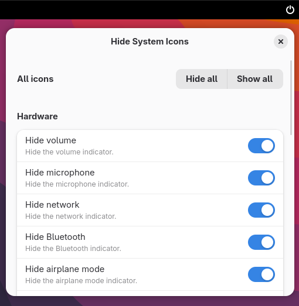

# Hide System Icons (GNOME Extension)

Hide specific system icons from the GNOME Quick Settings panel.



## Install

Install from GNOME Extensions: [Hide System Icons](https://extensions.gnome.org/extension/8558/hide-system-icons/)

## Compatibility

- Modern (ESM): GNOME Shell 45–51
- Legacy (legacy loader): GNOME Shell 40–44

## Features

- Hardware: hide volume, hide microphone, hide network, hide Bluetooth, hide airplane mode, hide Thunderbolt
- Display & Appearance: hide brightness, hide keyboard backlight, hide night light, hide dark mode, hide auto rotate
- Privacy & System: hide camera, hide location, hide screen sharing, hide power, hide power profiles, hide Do Not Disturb (GNOME 49+), hide background apps
- Changes apply immediately and persist across restarts

## Settings

Preferences: Extensions app → this extension → Preferences. Toggles are grouped:

- Hardware: hide volume, hide microphone, hide network, hide Bluetooth, hide airplane mode, hide Thunderbolt
- Display & Appearance: hide brightness, hide keyboard backlight, hide night light, hide dark mode, hide auto rotate
- Privacy & System: hide camera, hide location, hide screen sharing, hide power, hide power profiles, hide Do Not Disturb (GNOME 49+), hide background apps

"Hide all" / "Show all" at the top of the page apply to every toggle at once.
Hiding the camera, microphone, location or screen sharing indicator asks for
confirmation first (those icons are your only on-screen sign the sensor is in
use) — "Hide all" offers a "Keep privacy icons" option for exactly this
reason.

GSettings (advanced):

- Schema: `org.gnome.shell.extensions.hide-system-icons`
- Keys:
  - `hide-volume` (boolean)
  - `hide-microphone` (boolean)
  - `hide-camera` (boolean)
  - `hide-location` (boolean)
  - `hide-remote-access` (boolean)
  - `hide-network` (boolean)
  - `hide-bluetooth` (boolean)
  - `hide-rfkill` (boolean)
  - `hide-thunderbolt` (boolean)
  - `hide-brightness` (boolean)
  - `hide-backlight` (boolean)
  - `hide-night-light` (boolean)
  - `hide-dark-mode` (boolean)
  - `hide-auto-rotate` (boolean)
  - `hide-power` (boolean)
  - `hide-power-profiles` (boolean)
  - `hide-do-not-disturb` (boolean)
  - `hide-background-apps` (boolean)

## Manual installation (from source)

Prerequisites:

- make, zip, glib-compile-schemas
- Node.js and npm

```bash
npm install

# Build both modern (45–51) and legacy (40–44) packages
make pack

# Or build individually
make pack-modern
make pack-legacy

# Install the modern build (45–51) to ~/.local/share/gnome-shell/extensions
make install-modern

# Install the legacy build (40–44) to ~/.local/share/gnome-shell/extensions
make install-legacy
```

## Releasing

The project follows [Semantic Versioning](https://semver.org/), and `package.json` holds the version.

1. Add your changes under `## [Unreleased]` in `CHANGELOG.md`.
2. On an up-to-date `main` with a clean working tree, run `npm version patch`, `npm version minor` or `npm version major`. This bumps the version, dates the changelog section, commits `chore(release): vX.Y.Z` and creates the `vX.Y.Z` tag.
3. Run `git push --follow-tags`.

Pushing the tag runs the release workflow. It builds `hide-system-icons-X.Y.Z-gnome-45-51.zip` and `hide-system-icons-X.Y.Z-gnome-40-44.zip` and publishes them as a GitHub release, with the changelog section as the release notes. Uploading to extensions.gnome.org is still manual.

## License

MIT — see `LICENSE`.

